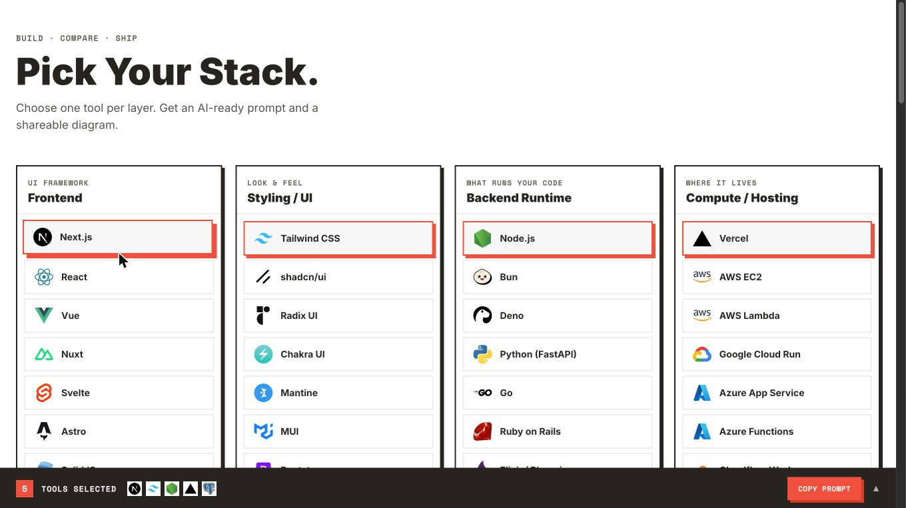

# Pick Your Stack

[](https://github.com/Hamicch/pick-your-stack/actions/workflows/ci.yml)

Choose one tool per layer. Get an AI-ready prompt and a shareable architecture diagram.



## Run locally

```bash
npm install
npm run dev
```
